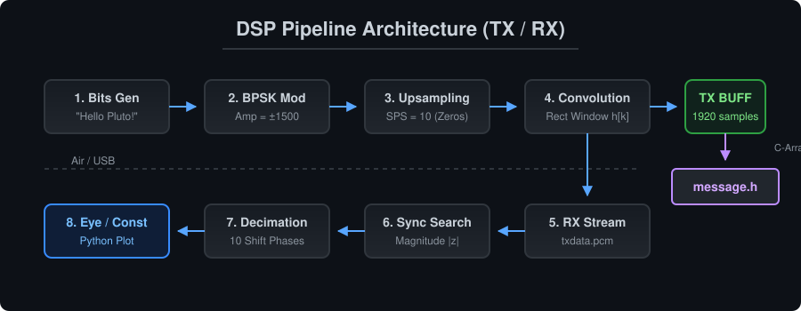

<div align="center">
  

  <br />

  
  
  
  
  
</div>

---

## Программно-определяемый приемопередатчик на базе Adalm-Pluto SDR

Репозиторий содержит исходный код, скрипты спектрального и временного анализа, а также инженерные отчеты по разработке цифровой системы связи на базе программно-определяемого радио **Analog Devices ADALM-PLUTO (PlutoSDR)**.

Проект охватывает полный цикл проектирования физического уровня (PHY): от базового приема радиовещательных сигналов в GNU Radio до низкоуровневой реализации приемопередатчика на языке C/C++ с использованием аппаратных временных меток (Hardware Timestamps), формирования импульсов методом дискретной свертки, BPSK-модуляции и алгоритмов символьной синхронизации.

* **Разработчик:** Богдан
* **Аппаратная платформа:** 2x ADALM-Pluto SDR (трансивер AD9361, ЦАП/АЦП 12 бит)
* **Рабочий диапазон:** 800 МГц (ширина полосы пропускания 1 МГц)

---

<!-- ===================================================================== -->
<!-- БЛОК SUMMARY: ТАБЛИЦА ОТЧЕТОВ ПО НЕДЕЛЯМ                              -->
<!-- Чтобы добавить новую неделю, скопируй последнюю строку таблицы ниже   -->
<!-- ===================================================================== -->

## Сводная таблица отчетов (Summary)

Все детальные отчеты с математическими выводами, графиками и разбором ошибок вынесены в отдельную директорию [`reports/`](reports/).

| Неделя | Период | Тема лабораторной работы | Ключевые технологии и результаты | Статус | Ссылка на отчет |
| :---: | :---: | :--- | :--- | :---: | :---: |
| **1** | Сентябрь | GNU Radio. Построение FM-радиоприемника | Децимация, ФНЧ, демодуляция WBFM, анализ спектра на 101.1 МГц |  | [reports/week1.md](reports/week1.md) |
| **3** | Сентябрь | Инициализация ADALM-Pluto и аппаратные метки времени (Timestamp) | SoapySDR, `timestamp_every=1920`, проверка интервала 1.92 мс |  | [reports/week3.md](reports/week3.md) |
| **4** | Октябрь | Работа с буферами I/Q-отсчетов в формате CS16 | Формирование огибающей в `tx_buff`, запись бинарных дампов `.pcm` |  | [reports/week4.md](reports/week4.md) |
| **5–7** | Октябрь | Радиоканал между двумя платами ADALM-Pluto | Разделение ролей `tx`/`rx`, синхронизация буферов, передача по эфиру |  | [reports/week5-7.md](reports/week5-7.md) |
| **8** | 26.10 – 01.11 | Передатчик BPSK, дискретная свертка и анализ искажений радиоканала | Upsampling, свертка, исследование CFO и утечки гетеродина (LO Leakage) |  | [reports/week8.md](reports/week8.md) |
| **9** | 02.11 – 08.11 | Приемник. Детерминированный кадр и выбор символьных отсчетов | Передача ASCII-сообщения, генерация `message.h`, децимация по 10 фазам |  | [reports/week9.md](reports/week9.md) |

<!-- ===================================================================== -->
<!-- КОНЕЦ БЛОКА SUMMARY                                                   -->
<!-- ===================================================================== -->

---

## Архитектура системы

<div align="center">
  
</div>

---

## Структура репозитория

В репозитории поддерживается строгая иерархия исходных файлов. Временные файлы сборки (`build/`), объектные файлы и тяжелые бинарные дампы радиоэфира (`*.pcm`) исключены из индексации через `.gitignore`.

```text
.
├── README.md                  # Документация проекта и навигация по отчетам
├── CMakeLists.txt             # Конфигурация системы сборки CMake
├── .gitignore                 # Исключение build/, *.pcm, *.o из Git
├── .gitmodules                # Конфигурация внешних подмодулей драйверов
├── assets/                    # Векторная графика (SVG) для документации
│   ├── header_banner.svg
│   └── dsp_pipeline.svg
├── include/                   # Заголовочные файлы проекта
│   └── message.h              # Автогенерируемый массив эталонных I/Q отсчетов
├── src/                       # Исходный код приемопередатчика на Си/C++
│   └── main.cpp               # Основной модуль работы с SoapySDR и ЦОС
├── scripts/                   # Скрипты постобработки и визуализации (Python)
│   └── readPcm.py             # Векторизованный анализ .pcm, созвездия и фаз
├── submodules/                # Внешние библиотеки (SoapySDR, libiio, SoapyPlutoSDR)
└── reports/                   # Инженерные отчеты по неделям + графики
    ├── week1.md
    ├── ...
    └── week9.md
```

---

## Установка и сборка проекта

### 1. Клонирование репозитория и инициализация сабмодулей

Проект использует специализированные ветки библиотек с поддержкой аппаратных таймстемпов ADALM-Pluto, подключенные через механизм `git submodule`.

```bash
git clone --recurse-submodules https://github.com/<ваш-логин>/SDR.git
cd SDR
```

Если репозиторий уже был склонирован без флага `--recurse-submodules`, загрузите подмодули командой:

```bash
git submodule update --init --recursive
```

### 2. Установка системных зависимостей (Linux Mint / Ubuntu / Debian)

```bash
sudo apt-get update
sudo apt-get install -y build-essential cmake pkg-config \
    libusb-1.0-0-dev libxml2-dev bison flex libcdk5-dev \
    libaio-dev libavahi-common-dev libavahi-client-dev \
    python3 python3-numpy python3-matplotlib swig
```

### 3. Сборка драйверов из подмодулей (при чистой установке)

Если библиотеки `SoapySDR`, `libiio` (`v0.24`), `libad9361-iio` и `SoapyPlutoSDR` (`sdr_gadget_timestamping`) еще не установлены в систему, соберите их последовательно из директории `submodules/` (либо из репозиториев `TelecomDep`):

```bash
# Пример сборки для каждого подмодуля (SoapySDR -> libiio -> libad9361-iio -> SoapyPlutoSDR)
cd submodules/SoapySDR
mkdir build && cd build
cmake ..
make -j$(nproc)
sudo make install
sudo ldconfig
```

### 4. Компиляция основного проекта

Сборка выполняется в изолированной директории `build/` (вне дерева исходного кода):

```bash
mkdir -p build && cd build
cmake ..
make -j$(nproc)
```

После успешной компиляции в директории `build/` появится исполняемый файл `main`.

---

## Инструкция по запуску

Проверка доступности подключенной платы ADALM-Pluto и определение ее URI выполняются утилитой:

```bash
iio_info -s
```

### Запуск в режиме приемника (RX)

На первом компьютере запускается приемник. Он инициализирует поток чтения, записывает принятые из эфира комплексные отсчеты в файл `build/txdata.pcm` и ожидает пакеты на протяжении 3000 буферов:

```bash
cd build
sudo ./main rx
```

### Запуск в режиме передатчика (TX)

На втором компьютере запускается передатчик. Программа формирует BPSK-сигнал из фиксированной текстовой строки, сохраняет эталонный массив сэмплов в заголовочный файл `message.h` и излучает каждый второй буфер в радиоэфир на частоте 800 МГц:

```bash
cd build
sudo ./main tx
```

### Визуализация и анализ данных

После завершения работы приемника запустите скрипт анализа из корневой директории проекта:

```bash
python3 scripts/readPcm.py
```
