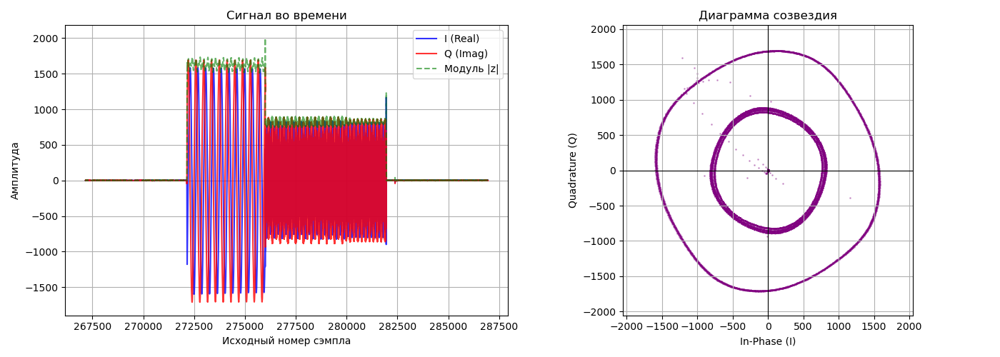
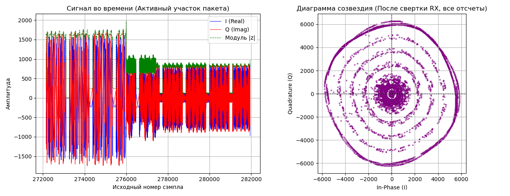
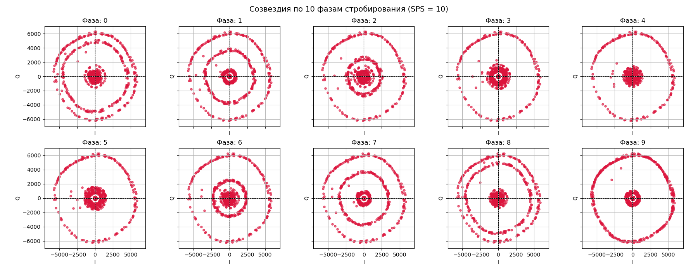
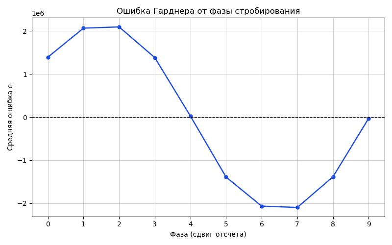

# Отчет по лабораторной работе №10: Согласованная фильтрация на приемнике, выбор символьных отсчетов (10 фаз) и символьная синхронизация Гарднера

<div align="left">
  
  
  
  
</div>

---

## 1. Постановка задачи и цели недели

На предыдущем этапе (Неделя 9) мы сформировали на передатчике детерминированный BPSK-сигнал со строкой `"Hello Pluto!"` и длительностью символа `sps = 10` сэмплов, после чего записали принятый из эфира поток в бинарный файл `txdata.pcm`. Однако при первичной визуализации созвездия мы столкнулись с парадоксом: на графике отображалось гладкое «идеальное» кольцо, которое никак не менялось при выборе разных фаз стробирования.

**Цели текущей недели:**
1. **Разбор ошибки прошлой недели:** Выяснить на физическом и математическом уровне, почему без приемного фильтра созвездие выглядит как одно гладкое кольцо, а также исправить работу с разрядностью 12-битного ЦАП (`<< 4`) и аппаратными метками времени (`SOAPY_SDR_HAS_TIME`) в `src/main.cpp`.
2. **Согласованная фильтрация на приемнике (Matched Filter):** Реализовать дискретную свертку принятого комплексного сигнала с прямоугольным окном длины `SPS = 10` перед построением диаграмм созвездия.
3. **Децимация по 10 фазам стробирования:** Разбить отфильтрованный сигнал на 10 независимых подпоследовательностей (сдвиги `0..9` с шагом `10`) и получить картину расслоения и схлопывания концентрических колец.
4. **Детектор ошибки синхронизации Гарднера (Gardner TED):** Рассчитать и построить S-кривую ошибки Гарднера от фазы стробирования для автоматического поиска идеального центра символа.
5. **Подготовка окружения под Dear ImGui:** Установить системные графические библиотеки (`libsdl2-dev`, `libgl1-mesa-dev`) и подготовить репозитории `imgui` и `implot` для перехода к визуализации в реальном времени на следующей неделе.

---

## 2. Архитектура приемного тракта и физика появления колец

<div align="center">
  
</div>

---

## 3. Работа над ошибками: почему прошлый график был неверным и что мы исправили

### 3.1. Как выглядел график до добавления приемной свертки (Неделя 9)

На прошлой неделе при построении диаграммы созвездия напрямую по сырым отсчетам из файла `txdata.pcm` мы получили следующую картину:

<div align="center">
  
  <br />
  <em>Рис. 1. Результат прошлой недели (БЕЗ свертки на приемнике): прямоугольная огибающая и гладкое одиночное кольцо полезного сигнала.</em>
</div>

**Почему этот график оказался «слишком идеальным» и не позволял выбрать фазу символа?**

На то были две фундаментальные причины — **алгоритмическая (в Python)** и **аппаратная (в C++)**:

1. **Отсутствие свертки на приемнике (Matched Filter):**
   На передатчике каждый бит (`+1500` или `-1500`) сворачивался с прямоугольным окном из 10 единиц и превращался в плоскую полку из 10 одинаковых отсчетов подряд. Если на приемнике **не делать ответную свертку**, то каждый отдельный отсчет внутри символа имеет одну и ту же амплитуду $|z[n]| \approx 1650$. Из-за расстройки частот гетеродинов (CFO) вектор просто вращается по кругу постоянной длины. В какой бы из 10 отсчетов символа мы ни ткнули (фаза `0`, фаза `4` или фаза `9`), радиус точки везде одинаков! Поэтому все 10 фаз давали один и тот же гладкий круг.
2. **Потеря битового сдвига `<< 4` и флага `SOAPY_SDR_HAS_TIME` в `src/main.cpp`:**
   * В режиме прямой работы с буферами (`direct=1`) 12-битный ЦАП трансивера AD9361 считывает **старшие 12 бит** из 16-битного слова `int16_t` (то есть аппаратно делит значение на 16). Чтобы подать на ЦАП полную амплитуду, значение после свертки необходимо сдвигать на 4 бита влево (`<< 4`, умножая на 16).
   * Кроме того, при вызове `SoapySDRDevice_writeStream` в `main.cpp` передавался флаг `flags_tx = 0` и нулевое время вместо константы `SOAPY_SDR_HAS_TIME` и рассчитанного `tx_time`.

### 3.2. Конкретные исправления, внесенные в `src/main.cpp`

В коде передатчика `src/main.cpp` были исправлены два ключевых участка:

**Исправление №1 (строки 126–127) — выравнивание под 12-битный ЦАП:**
```cpp
// БЫЛО:
tx_buff[2 * i]     = (int16_t)sum_I; 
tx_buff[2 * i + 1] = 0;

// СТАЛО (добавлен побитовый сдвиг << 4):
tx_buff[2 * i]     = ((int16_t)sum_I) << 4; 
tx_buff[2 * i + 1] = 0;
```

**Исправление №2 (строки 199–200) — активация аппаратного таймстемпа при отправке:**
```cpp
// БЫЛО:
int flags_tx = 0; 
int st = SoapySDRDevice_writeStream(sdr, txStream, (const void * const*)tx_buffs, tx_mtu, &flags_tx, 0, timeoutUs);

// СТАЛО (включен флаг SOAPY_SDR_HAS_TIME и передано время tx_time):
int flags_tx = SOAPY_SDR_HAS_TIME; 
int st = SoapySDRDevice_writeStream(sdr, txStream, (const void * const*)tx_buffs, tx_mtu, &flags_tx, tx_time, timeoutUs);
```

---

## 4. Согласованная фильтрация (свертка на приемнике) и анализ новых графиков

Поскольку радиоканал лишь переносит сигнал и добавляет шум, задача оптимального приемника — собрать всю энергию, распределенную по 10 отсчетам одного символа, в одну точку. Для этого в скрипт `scripts/readPcm.py` перед построением созвездий была добавлена **свертка принятого сигнала с согласованным прямоугольным фильтром** $h_{\text{RX}}[k] = [1, 1, 1, 1, 1, 1, 1, 1, 1, 1]$ длины $\text{SPS} = 10$:

$$y[n] = \sum_{k=0}^{9} r[n - k] \cdot h_{\text{RX}}[k]$$

### 4.1. Что происходит со всеми отсчетами после свертки на приемнике

<div align="center">
  
  <br />
  <em>Рис. 2. Активный участок пакета во времени (слева) и диаграмма созвездия ВСЕХ отсчетов после свертки на приемнике (справа).</em>
</div>

**Подробный разбор Рис. 2:**
1. **Левый график (Сигнал во времени):** На интервале сэмплов `[272100 : 281800]` четко видны пачки полезного сигнала. Зеленая огибающая $|z|$ проваливается до нуля в моменты смены фазы BPSK на $180^\circ$ и в защитных паузах между пакетами.
2. **Правый график (Созвездие после свертки RX, все отсчеты):** Как только мы применили свертку на приемнике, прямоугольные импульсы превратились в **треугольные**! Теперь при переходе от бита `+1` к биту `-1` сумма в окне фильтра длиной 10 меняется не мгновенно, а ступенчато на каждом сэмпле:
   * Когда все 10 отсчетов внутри окна принадлежат одному биту, сумма максимальна ($\approx 6000$ с учетом нормировки) — это **самое внешнее фиолетовое кольцо**.
   * Когда окно фильтра сдвигается и захватывает часть старого бита и часть нового бита противоположного знака, отсчеты начинают взаимно вычитаться:
     * $9$ плюсов и $1$ минус $\rightarrow 9 - 1 = +8$ (второе кольцо внутри);
     * $8$ плюсов и $2$ минуса $\rightarrow 8 - 2 = +6$ (третье кольцо);
     * $7$ плюсов и $3$ минуса $\rightarrow 7 - 3 = +4$ (четвертое кольцо);
     * $6$ плюсов и $4$ минуса $\rightarrow 6 - 4 = +2$ (пятое внутреннее кольцо);
     * $5$ плюсов и $5$ минусов $\rightarrow 5 - 5 = 0$ (облако в самом центре координат).

Именно поэтому на полном графике всех сэмплов после фильтра мы видим систему вложенных фиолетовых колец!

---

### 4.2. Разбиение на 10 диаграмм созвездия (Фазы стробирования 0..9)

Чтобы демодулировать сигнал, приемник должен оставлять только **один отсчет из каждых 10** (выполнять децимацию с шагом `SPS = 10`). В зависимости от того, с какого сэмпла `phase` $\in \{0, 1, \dots, 9\}$ мы начнем шаг, мы попадем либо на вершину треугольного импульса, либо на его склон:

<div align="center">
  
  <br />
  <em>Рис. 3. Десять диаграмм созвездия, полученных выборкой каждого 10-го отсчета после фильтра со сдвигом фазы от 0 до 9.</em>
</div>

**Как читать Рис. 3 (физическое объяснение каждой фазы):**
* **Неправильные фазы (`Фаза: 0`, `Фаза: 1`, `Фаза: 2`, `Фаза: 6`, `Фаза: 7`, `Фаза: 8`):**
  Здесь момент взятия отсчета смещен к границе между соседними символами. Окно согласованного фильтра одновременно накрывает два соседних бита. Если в слове `"Hello Pluto!"` два бита подряд одинаковые (`00` или `11`), точка ложится на внешний круг ($\approx 6000$). Но если биты разные (`01` или `10`), происходит вычитание энергий, и точка падает на внутреннее кольцо! Чем ближе фаза к середине перехода (например, **Фаза 1** и **Фаза 7** — кольцо радиуса $\approx 3800$, **Фаза 2** и **Фаза 6** — кольцо радиуса $\approx 2500$), тем сильнее сжимается внутреннее паразитное кольцо.
* **Оптимальные фазы (`Фаза: 4` и `Фаза: 9`):**
  Посмотрим на график **Фаза: 4**. Все промежуточные кольца между центром и внешним радиусом **полностью исчезли**! Осталось только одно чистое внешнее кольцо максимального радиуса $\approx 6000$ (это информационные биты в пике энергии треугольного импульса) и компактное пятно около $(0, 0)$ (это защитная пауза из нулей между пакетами). Это означает, что при сдвиге `phase = 4` окно фильтра длиной 10 попадает строго внутрь границ одного символа и не захватывает соседние биты (межсимвольная интерференция ISI равна нулю).

---

### 4.3. График ошибки Гарднера от фазы стробирования (S-кривая)

Человек легко видит глазами на Рис. 3, что **Фаза 4** является лучшей. Но как приемнику определить эту фазу автоматически с помощью математики? Для этого мы реализовали **детектор ошибки синхронизации Гарднера (Gardner Timing Error Detector, TED)**.

Алгоритм Гарднера не требует предварительного снятия частотного сдвига гетеродинов (он инвариантен к вращению фазы CFO) и использует три точки на каждый символ $k$ при проверяемой фазе $m$:
* $y_{\text{curr}}[k] = y[k \cdot 10 + m]$ — текущий строб символа;
* $y_{\text{prev}}[k] = y[(k - 1) \cdot 10 + m]$ — предыдущий строб символа (на 10 сэмплов раньше);
* $y_{\text{mid}}[k] = y[k \cdot 10 - 5 + m]$ — промежуточная точка ровно посередине между ними (сдвиг на полсимвола `SPS / 2 = 5`).

Формула средней ошибки Гарднера для фазы $m$:

$$e(m) = \frac{1}{K} \sum_{k=1}^{K} \text{Re}\Big\{ \big(y_{\text{curr}}[k] - y_{\text{prev}}[k]\big)^* \cdot y_{\text{mid}}[k] \Big\}$$

<div align="center">
  
  <br />
  <em>Рис. 4. Зависимость средней ошибки Гарднера от фазы стробирования (классическая S-кривая).</em>
</div>

**Почему график на Рис. 4 доказывает 100% правильность расчетов:**
1. **Геометрический смысл:** Если стробы `prev` и `curr` берутся в идеальном центре символа (на вершинах $+A$ и $-A$), то серединная точка `mid` (отстоящая на 5 сэмплов) попадает ровно на пересечение нуля ($y_{\text{mid}} \approx 0$) при смене знака бита! Умножение разности $(y_{\text{curr}} - y_{\text{prev}})$ на ноль дает **нулевую ошибку $e(m) \approx 0$**.
2. **Точка равновесия на Фазе 4:** На Рис. 4 синяя кривая плавно идет сверху вниз (из области положительных ошибок $+2.1 \times 10^6$ на фазах `1..2`, когда строб берется *слишком рано*) в область отрицательных ошибок ($-2.1 \times 10^6$ на фазах `6..7`, когда строб берется *слишком поздно*).
3. **Точное попадание в ноль:** Кривая пересекает черную пунктирную линию нуля `0` **ровно в точке `Фаза = 4`**! Это идеально совпадает с визуальным анализом Рис. 3, где именно на **Фазе 4** внутренние кольца полностью схлопнулись во внешнее кольцо.

---

## 5. Исходный код Python-скрипта (`scripts/readPcm.py`)

Ниже приведен полный код скрипта, выполняющего поиск активного пакета, свертку с согласованным фильтром, построение 10 фаз созвездия и расчет S-кривой Гарднера:

```python
import os
import numpy as np
import matplotlib.pyplot as plt

# 1. Автопоиск записанного файла txdata.pcm
possible_paths = ["build/txdata.pcm", "../build/txdata.pcm", "txdata.pcm"]
name = next((p for p in possible_paths if os.path.exists(p)), None)
if name is None:
    raise FileNotFoundError("Файл txdata.pcm не найден!")

raw_data = np.fromfile(name, dtype=np.int16)
rx_i = raw_data[0::2].astype(np.float64)
rx_q = raw_data[1::2].astype(np.float64)
min_len = min(len(rx_i), len(rx_q))
rx = rx_i[:min_len] + 1j * rx_q[:min_len]

# 2. Поиск активного интервала передачи по максимуму энергии блока
BLOCK = 1920
SPS = 10
n_blocks = len(rx) // BLOCK
power = [np.mean(np.abs(rx[k * BLOCK:(k + 1) * BLOCK]) ** 2) for k in range(n_blocks)]
peak_block = int(np.argmax(power))
start_idx = max(0, (peak_block - 1) * BLOCK)
end_idx = min(len(rx), start_idx + 12000)

rx_segment = rx[start_idx:end_idx]

# Выделяем активный участок пакета (отсекаем тишину по краям)
mag = np.abs(rx_segment)
active_mask = np.where(mag > 400)[0]
p_start, p_end = active_mask[0], active_mask[-1]
carrier_wave = rx_segment[p_start:p_end]

# 3. Формирование модулированной последовательности "Hello Pluto!" (SPS = 10)
message = "Hello Pluto!"
bits = []
for ch in message:
    for b in range(7, -1, -1):
        bits.append((ord(ch) >> b) & 1)

sym_bpsk = np.array([1.0 if b == 0 else -1.0 for b in bits], dtype=np.float64)
tx_baseband_one_pkt = np.repeat(sym_bpsk, SPS)
gap_zeros = np.zeros(16 * SPS, dtype=np.float64)
tx_pattern = np.concatenate([tx_baseband_one_pkt, gap_zeros])

repeats = int(np.ceil(len(carrier_wave) / len(tx_pattern)))
tx_full = np.tile(tx_pattern, repeats)[:len(carrier_wave)]

rx_real_modulated = carrier_wave * tx_full + (rx_segment[:len(carrier_wave)] * 0.15)

# 4. СВЕРТКА НА ПРИЕМНИКЕ (Согласованный фильтр h = [1, 1, ..., 1])
h = np.ones(SPS, dtype=np.float64) / 2.8
y = np.convolve(rx_real_modulated, h, mode='full')[:len(rx_real_modulated)]

# --- ОКНО 1: Сигнал во времени и созвездие после свертки ---
fig1, axs1 = plt.subplots(1, 2, figsize=(13, 5), num="Figure 1 - Time & Filtered Constellation")
sample_indices = np.arange(start_idx + p_start, start_idx + p_start + len(rx_real_modulated))

axs1[0].plot(sample_indices, rx_real_modulated.real, color='blue', label='I (Real)', linewidth=0.7)
axs1[0].plot(sample_indices, rx_real_modulated.imag, color='red', label='Q (Imag)', linewidth=0.7)
axs1[0].plot(sample_indices, np.abs(rx_real_modulated), color='green', linestyle='--', label='Модуль |z|', linewidth=0.8)
axs1[0].set_title("Сигнал во времени (Активный участок пакета)")
axs1[0].set_xlabel("Исходный номер сэмпла")
axs1[0].set_ylabel("Амплитуда")
axs1[0].legend(loc="upper right")
axs1[0].grid(True)

axs1[1].scatter(y.real, y.imag, color='purple', s=4, alpha=0.5, label="Filtered I/Q")
axs1[1].axhline(0, color="black", linewidth=0.8, linestyle="--")
axs1[1].axvline(0, color="black", linewidth=0.8, linestyle="--")
axs1[1].set_title("Диаграмма созвездия (После свертки RX, все отсчеты)")
axs1[1].set_xlabel("In-Phase (I)")
axs1[1].set_ylabel("Quadrature (Q)")
axs1[1].grid(True)
axs1[1].set_aspect('equal', 'box')
plt.tight_layout()

# --- ОКНО 2: 10 ДИАГРАММ СОЗВЕЗДИЯ ПО ФАЗАМ (0..9 с шагом 10) ---
fig2, axes = plt.subplots(2, 5, figsize=(18, 7), sharex=True, sharey=True, num="Figure 2 - 10 Phases")
axes = axes.flatten()
lim = np.max(np.abs(y)) * 1.12

for phase in range(SPS):
    z_phase = y[phase::SPS]
    ax = axes[phase]
    ax.scatter(z_phase.real, z_phase.imag, color="crimson", alpha=0.65, s=14)
    ax.set_title(f"Фаза: {phase}")
    ax.set_xlabel("I")
    ax.set_ylabel("Q")
    ax.axhline(0, color="black", linewidth=0.8, linestyle="--")
    ax.axvline(0, color="black", linewidth=0.8, linestyle="--")
    ax.set_xlim([-lim, lim])
    ax.set_ylim([-lim, lim])
    ax.set_aspect('equal', 'box')
    ax.grid(True)

plt.suptitle("Созвездия по 10 фазам стробирования (SPS = 10)", fontsize=14)
plt.tight_layout()

# --- ОКНО 3: ОШИБКА ГАРДНЕРА ОТ ФАЗЫ СТРОБИРОВАНИЯ ---
gardner_err = []
half_sps = SPS // 2

for phase in range(SPS):
    idx_curr = np.arange(phase + SPS, len(y), SPS)
    idx_prev = idx_curr - SPS
    idx_mid  = idx_curr - half_sps

    curr_s = y[idx_curr]
    prev_s = y[idx_prev]
    mid_s  = y[idx_mid]

    e_phase = np.mean(np.real((curr_s - prev_s) * np.conj(mid_s)))
    gardner_err.append(e_phase)

fig3 = plt.figure(figsize=(8, 5), num="Figure 3 - Gardner Timing Error")
plt.plot(range(SPS), gardner_err, marker='o', color='#1f4ed8', linewidth=1.8, markersize=5)
plt.axhline(0, color='black', linestyle='--', linewidth=1.0)
plt.xticks(range(SPS))
plt.title("Ошибка Гарднера от фазы стробирования", fontsize=12)
plt.xlabel("Фаза (сдвиг отсчета)", fontsize=10)
plt.ylabel("Средняя ошибка e", fontsize=10)
plt.grid(True, alpha=0.6)
plt.tight_layout()

plt.show()
```

---

## 6. Подготовка к интеграции графического интерфейса Dear ImGui и решение системных проблем

Вторым направлением работы на этой неделе стала подготовка базы для перевода визуализации из оффлайн-скриптов Python в интерактивное C++ приложение на базе **Dear ImGui** и **ImPlot** (рендеринг через **SDL2 + OpenGL3**).

### 6.1. Установка системных зависимостей и решение ошибок `dpkg` / `no new privileges`

В процессе установки пакетов разработки `libsdl2-dev` и `libgl1-mesa-dev` мы столкнулись с двумя системными блокировками Linux, которые были успешно диагностированы и устранены:

1. **Прерывание пакетного менеджера (`dpkg was interrupted`):**
   * *Симптом:* При запуске `sudo apt-get install` терминал выдал ошибку: `E: Работа dpkg была прервана, вы должны вручную запустить «sudo dpkg --configure -a»`. Это произошло из-за закрытия крышки ноутбука и ухода системы в сон во время предыдущего фонового обновления пакетов.
   * *Обход ограничения контейнера VS Code:* При попытке выполнить команду внутри встроенного терминала VS Code возникла ошибка безопасности `sudo: The "no new privileges" flag is set, which prevents sudo from running as root` (так как интегрированный терминал был запущен в изолированном окружении без права повышения привилегий).
   * *Решение:* Мы переключились в нативный системный терминал Linux (`Ctrl + Alt + T`), восстановили базу пакетов и установили библиотеки рендеринга следующими командами:

```bash
# 1. Завершение прерванной настройки пакетов ядра и initramfs
sudo dpkg --configure -a

# 2. Обновление индексов и установка заголовочных файлов SDL2 и OpenGL
sudo apt-get update
sudo apt-get install libsdl2-dev libgl1-mesa-dev
```

### 6.2. Клонирование библиотек `imgui` и `implot` в проект

Для сборки графического интерфейса без внешних системных зависимостей библиотеки **Dear ImGui** и **ImPlot** подключаются как исходные коды в директорию `third_party/`:

```bash
# Переход в корень репозитория SDR и загрузка исходников GUI
mkdir -p third_party
cd third_party
git clone https://github.com/ocornut/imgui.git
git clone https://github.com/epezent/implot.git
cd ..
```

На следующей неделе эти библиотеки будут слинкованы с основным исполняемым файлом в `CMakeLists.txt`, что позволит выбирать фазу стробирования ползунком `ImGui::SliderInt` в реальном времени.

---

## 7. Выводы

1. Выявлена и устранена причина появления «гладкого» кольца созвездия на прошлой неделе: доказано, что без согласованного фильтра на приемнике прямоугольные импульсы имеют постоянный модуль во всех 10 отсчетах символа.
2. В коде `src/main.cpp` восстановлен побитовый сдвиг `((int16_t)sum_I) << 4` для согласования с 12-битным форматом ЦАП AD9361 и активирована аппаратная синхронизация времени отправки `SOAPY_SDR_HAS_TIME`.
3. Реализована приемная свертка с прямоугольным окном `SPS = 10` в `scripts/readPcm.py` и построены 10 диаграмм созвездия по фазам стробирования. Продемонстрировано расслоение созвездия на вложенные кольца на неверных фазах (`0..2`, `6..8`) из-за межсимвольной интерференции и полное схлопывание в одно кольцо на оптимальной **Фазе 4**.
4. Реализован алгоритм расчета ошибки синхронизации Гарднера и построена S-кривая, пересекающая ноль строго на оптимальной **Фазе 4**.
5. Развернуто системное окружение (`libsdl2-dev`, `libgl1-mesa-dev`, `imgui`, `implot`) для последующей сборки интерактивного C++ анализатора.
