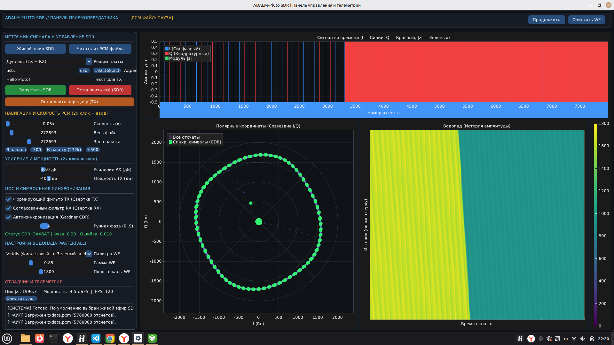

# Отчет по лабораторной работе №11: Интерактивный веб-дашборд на Dear ImGui + ImPlot и замкнутая петля символьной синхронизации Гарднера (Gardner CDR)
<div align="left">
  
  
  
  
  
</div>

---

## 1. Постановка задачи и цели недели

На предыдущей неделе (Неделя 10) мы в оффлайн-режиме на Python доказали необходимость согласованной фильтрации на приемнике ($\text{SPS} = 10$), построили 10 фаз стробирования и вычислили разомкнутую S-кривую ошибки Гарднера, которая указала на оптимальную фазу выборки. Однако в реальных системах радиосвязи тактовые генераторы передатчика и приемника независимы и непрерывно дрейфуют во времени, поэтому фиксированный выбор одной фазы (`0..9`) не может удерживать синхронизацию бесконечно. Кроме того, оффлайн-анализ через Python не позволяет управлять приемопередатчиком ADALM-Pluto и наблюдать реакцию сигнала в реальном времени.

**Цели текущей недели:**

1. **Разработка интерактивного графического дашборда (`gui.cpp`) на C++ (SDL2 + OpenGL3 + Dear ImGui + ImPlot):** Полностью уйти от статических скриптов визуализации к нативному C++ приложению, работающему на частоте $120\text{ FPS}$, с поддержкой кириллицы, живой перестройкой водопада (Waterfall), полярной сеткой созвездия и управлением трансивером ADALM-Pluto в реальном времени.
2. **Реализация замкнутой петли посимвольной синхронизации (Closed-Loop Gardner CDR):** Внедрить в код (`main.cpp` и `gui.cpp`) полноценную цифровую систему тактовой автоподстройки (All-Digital PLL) строго по **Главе 6 учебника *"Software-Defined Radio for Engineers"* (T. Collins, R. Getz, D. Pu, A. Wyglinski)**:
   * Кусочно-параболический интерполятор Фарроу (Piecewise Polynomial Filter) для вычисления сигнала в дробных точках $\mu \in [0, 1)$;
   * Детектор тактовой ошибки Гарднера (Gardner TED), не чувствительный к вращению фазы несущей (CFO);
   * Пропорционально-интегральный (ПИ) петлевой фильтр 2-го порядка и контроллер шага выборки.
3. **Решение инженерных проблем интеграции и визуализации:** Устранить ошибки совместимости с новым API `ImPlotSpec`, ускорить компиляцию тяжелых шаблонов `implot_items.cpp`, обеспечить синхронную перемотку всех трех графиков (включая ретроспективную перестройку истории Waterfall) и добиться идентичности динамического созвездия с эталонным многофазным графиком прошлой недели.

---

## 2. Архитектура замкнутой петли синхронизации Гарднера и конвейера GUI

Ниже представлена векторная блок-схема, отражающая реализованный в C++ конвейер обработки сигнала: от многопоточного чтения I/Q буферов через `SoapySDR` и согласованной свертки до замкнутого контура Гарднера с интерполятором Фарроу и отрисовки в `ImPlot`:

<div align="center">


</div>

---

## 3. Теория посимвольной синхронизации в методическом пособии и её перевод в наш C++ код

В **Главе 6 («Timing Synchronization», стр. 191–212)** методического пособия *Software-Defined Radio for Engineers* подробно разбирается физика рассинхронизации тактовых генераторов передатчика и приемника. Принятый непрерывный сигнал после прохождения радиоканала имеет неизвестную дробную задержку $\tau(t)$:

$$r(t) = \sum_{n} x(n) h(t - \tau(t) - nT_s) + v(t)$$

После прохождения согласованного приемного фильтра (Matched Filter) прямоугольные импульсы превращаются в треугольные (автокорреляционная функция импульса $h_A(t) = h(t) * h^*(-t)$). Чтобы максимизировать отношение сигнал/шум (SNR) и полностью устранить межсимвольную интерференцию (ISI), выборку необходимо брать строго в пике треугольного импульса — в точке максимального раскрытия «глазковой диаграммы» (Eye Diagram, рис. 6.13 методички).

Так как задержка $\tau(t)$ является **дробной частью периода дискретизации** и медленно плывет из-за нестабильности кварцевых резонаторов ($25\text{ ppm}$ на ADALM-Pluto), простая децимация по целочисленным индексам массива неспособна удерживать пик символа. В методичке (раздел **6.3.2 Feedback Timing Correction**, рис. 6.12 и 6.14) вводится замкнутая структура цифровой ФАПЧ (PLL) из четырех узлов:

| Узел по учебнику (Chapter 6) | Математическая задача узла | Реализация в нашем C++ коде (`main.cpp` и `gui.cpp`) |
| :--- | :--- | :--- |
| **1. Interpolator (Piecewise Polynomial Filter, стр. 205)** | Вычисление значения комплексного сигнала $I/Q$ в произвольный дробный момент времени $n + \mu_k$, где $\mu_k \in [0, 1)$, по 4 соседним отсчетам АЦП. | Функция `InterpolateFarrow()`: реализует 4-точечную кусочно-параболическую схему Фарроу с параметром $\alpha = 0.5$ по формуле (6.17). |
| **2. Timing Error Detector (Gardner TED, стр. 208)** | Оценка знака и величины отклонения строба от центра символа по трем точкам: предыдущий символ $y_{\text{prev}}$, середина перехода $y_{\text{mid}}$ и текущий символ $y_{\text{curr}}$. | Внутри `RunGardnerSymbolSync()`: вычисление $e[k] = \text{Re}\{(y_{\text{curr}} - y_{\text{prev}})^* \cdot y_{\text{mid}}\}$ согласно уравнению (6.19) с нормировкой на мощность пакета. |
| **3. Loop Filter (PI Filter, стр. 201, 206)** | Сглаживание шума детектора и формирование управляющего воздействия $\delta_k$ (пропорциональная + интегральная ветви 2-го порядка). | Переменные `Kp = 0.40f`, `Ki = 0.02f` и статический накопитель `integrator`, вычисляющие сдвиг `delta = Kp * err_norm + integrator`. |
| **4. Interpolation Controller (Modulo-1 Counter, стр. 203–207)** | Вычисление позиции следующего строба символа и выделение целого индекса отсчета $n = \lfloor \text{pos} \rfloor$ и дробного остатка $\mu = \text{pos} - n$. | Накопитель дробной позиции `pos += (float)sps - delta` с сохранением фазы `phase_offset` между кадрами. |

---

### 3.1. Кусочно-параболический интерполятор Фарроу (формула 6.17 методички)

В разделе 6.3.2 учебника (стр. 205, уравнение 6.17 и листинг `Code 6.2 interpFilter.m`) для вычисления отсчета между узлами сетки дискретизации используется кусочно-параболический фильтр (Piecewise Parabolic Filter, PPF) с коэффициентом $\alpha = 0.5$ и четырьмя коэффициентами:

$$h = \left[ \alpha\mu(\mu - 1), \quad -\alpha\mu^2 - (1 - \alpha)\mu + 1, \quad -\alpha\mu^2 + (1 + \alpha)\mu, \quad \alpha\mu(\mu - 1) \right]$$

Если сгруппировать члены этого полинома по степеням дробной задержки $\mu \in [0, 1)$ по схеме Горнера (как в структуре Фарроу), мы получаем квадратичный полином от четырех соседних отсчетов $x[n-1], x[n], x[n+1], x[n+2]$:

$$y(n + \mu) = (v_2 \cdot \mu + v_1) \cdot \mu + v_0$$

где коэффициенты при $\alpha = 0.5$ равны:

$$v_2 = \frac{1}{2}\left(x[n+2] - x[n+1] - x[n] + x[n-1]\right)$$

$$v_1 = \frac{1}{2}\left(-x[n+2] + 3x[n+1] - x[n] - x[n-1]\right)$$

$$v_0 = x[n]$$

**Наша реализация в C++ (`main.cpp` и `gui.cpp`):**

```cpp
// Кусочно-параболический интерполятор Фарроу (дробная задержка mu в [0, 1))
static inline void InterpolateFarrow(const std::vector<float>& xI, const std::vector<float>& xQ,
                                     float pos, float& outI, float& outQ) {
    int n = (int)std::floor(pos);
    float mu = pos - (float)n;
    int max_idx = (int)xI.size() - 1;

    int i_m1 = std::clamp(n - 1, 0, max_idx);
    int i_0  = std::clamp(n,     0, max_idx);
    int i_p1 = std::clamp(n + 1, 0, max_idx);
    int i_p2 = std::clamp(n + 2, 0, max_idx);

    // Схема Горнера для синфазной компоненты I
    float v2_I = 0.5f * (xI[i_p2] - xI[i_p1] - xI[i_0] + xI[i_m1]);
    float v1_I = 0.5f * (-xI[i_p2] + 3.0f * xI[i_p1] - xI[i_0] - xI[i_m1]);
    outI = (v2_I * mu + v1_I) * mu + xI[i_0];

    // Схема Горнера для квадратурной компоненты Q
    float v2_Q = 0.5f * (xQ[i_p2] - xQ[i_p1] - xQ[i_0] + xQ[i_m1]);
    float v1_Q = 0.5f * (-xQ[i_p2] + 3.0f * xQ[i_p1] - xQ[i_0] - xQ[i_m1]);
    outQ = (v2_Q * mu + v1_Q) * mu + xQ[i_0];
}
```

---

### 3.2. Детектор ошибки Гарднера (формула 6.19 методички) и ПИ-фильтр

В разделе **6.4.1 «Gardner» (стр. 208)** авторы учебника подчеркивают главное преимущество детектора Гарднера перед методом пересечения нуля (Zero-Crossing): **алгоритм Гарднера инвариантен к сдвигу фазы и частоты несущей (CFO)**, поэтому он может работать *до* петли Костаса, когда созвездие BPSK/QPSK еще вращается по кругу.

Формула ошибки Гарднера (6.19 из учебника):

$$e(k) = \text{Re}\{y((k - 1/2)T_s + \tau)\} \cdot \left[ \text{Re}\{y((k - 1)T_s + \tau)\} - \text{Re}\{y(kT_s + \tau)\} \right] + \text{Im}\{y((k - 1/2)T_s + \tau)\} \cdot \left[ \text{Im}\{y((k - 1)T_s + \tau)\} - \text{Im}\{y(kT_s + \tau)\} \right]$$

В нашем коде для каждого символа с помощью `InterpolateFarrow` берутся ровно эти три дробных отсчета на расстоянии половины символа (`0.5f * sps = 5.0` сэмплов):
* `curr` — в точке `pos` (текущий пик символа);
* `mid` — в точке `pos - 0.5f * sps` (середина перехода между символами);
* `prev` — в точке `pos - 1.0f * sps` (предыдущий пик символа).

Поскольку в нашем эксперименте передача ведется пакетами (между которыми идет эфирная тишина), мы добавили **энергетический порог (`power_gate`)**: ПИ-фильтр обновляет фазу только тогда, когда в окне присутствует реальный пакет (`p_avg > power_gate`), и замораживает состояние на паузах тишины, чтобы шум эфира не сбивал захваченную фазу!

```cpp
// Замкнутый контур символьной синхронизации Гарднера (Gardner CDR + PI Loop Filter)
static GardnerSyncTelemetry RunGardnerSymbolSync(const std::vector<float>& proc_I,
                                                 const std::vector<float>& proc_Q,
                                                 std::vector<float>& out_sym_I,
                                                 std::vector<float>& out_sym_Q,
                                                 int sps) {
    out_sym_I.clear();
    out_sym_Q.clear();
    GardnerSyncTelemetry tel;

    int n = (int)proc_I.size();
    if (n < sps * 4) return tel;

    float peak = 0.0f;
    for (int i = 0; i < n; ++i) {
        peak = std::max(peak, std::sqrt(proc_I[i] * proc_I[i] + proc_Q[i] * proc_Q[i]));
    }
    float power_gate = (peak * 0.25f) * (peak * 0.25f);
    if (peak < 15.0f) return tel;

    const float Kp = 0.40f;
    const float Ki = 0.02f;
    static float integrator = 0.0f;
    static float phase_offset = 0.0f;
    float pos = (float)sps + phase_offset;

    double err_acc = 0.0;
    int err_cnt = 0;

    while (pos < (float)(n - 3)) {
        float curr_I, curr_Q, mid_I, mid_Q, prev_I, prev_Q;
        InterpolateFarrow(proc_I, proc_Q, pos, curr_I, curr_Q);
        InterpolateFarrow(proc_I, proc_Q, pos - 0.5f * (float)sps, mid_I, mid_Q);
        InterpolateFarrow(proc_I, proc_Q, pos - 1.0f * (float)sps, prev_I, prev_Q);

        out_sym_I.push_back(curr_I);
        out_sym_Q.push_back(curr_Q);

        float p_avg = 0.5f * (curr_I * curr_I + curr_Q * curr_Q + prev_I * prev_I + prev_Q * prev_Q);
        float delta = 0.0f;
        if (p_avg > power_gate) {
            // Детектор Гарднера (ур. 6.19): Re{ (curr - prev)^* * mid }
            float ted_raw = (curr_I - prev_I) * mid_I + (curr_Q - prev_Q) * mid_Q;
            float err_norm = std::clamp(ted_raw / (p_avg + 1e-6f), -1.0f, 1.0f);

            // Пропорционально-интегральный (ПИ) фильтр петли (Code 6.4 методички)
            integrator = std::clamp(integrator + Ki * err_norm, -0.5f, 0.5f);
            delta = Kp * err_norm + integrator;

            err_acc += std::abs(err_norm);
            err_cnt++;
        }
        // Шаг до следующего символа с коррекцией фазы
        pos += (float)sps - delta;
    }

    float rem = std::fmod(pos, (float)sps);
    if (rem < 0.0f) rem += (float)sps;
    phase_offset = rem;
    tel.locked_phase = rem;
    tel.mean_ted_error = (err_cnt > 0) ? (float)(err_acc / err_cnt) : 0.0f;
    tel.is_locked = (err_cnt > 15 && tel.mean_ted_error < 0.18f);
    return tel;
}
```

---

## 4. Обзор разработанного веб-интерфейса на Dear ImGui + ImPlot (`gui.cpp`)

Ниже представлен общий вид разработанного графического приложения в момент захвата пакета BPSK и работы замкнутой петли синхронизации Гарднера:

<div align="center">
  
  <br>
  <em>Рис. 1. Рабочее окно программы gui: слева — сайдбар управления SDR, навигации и ЦОС; справа — осциллограмма I/Q/|z|, полярное созвездие с захватом CDR и тепловая карта водопада.</em>
</div>


### 4.1. Полный перечень возможностей интерфейса

#### Блок 1. Верхняя панель навигации и статуса (Top Navbar)
* **Индикатор текущего режима:** Динамически отображает состояние тракта: `[ЖИВОЙ ЭФИР SDR: ОЖИДАНИЕ]`, `[SDR: RX + TX АКТИВНЫ]`, `[SDR: ТОЛЬКО RX (TX ОСТАНОВЛЕН)]` или `[PCM ФАЙЛ: ПАУЗА / СКОРОСТЬ]`.
* **Быстрые действия:** Кнопка `Пауза / Продолжить` (также продублирована горячей клавишей **`Пробел`**) мгновенно замораживает все три графика для детального изучения пакета; кнопка `Очистить WF` сбрасывает историю водопада.

#### Блок 2. Источник сигнала и прямое управление трансивером ADALM-Pluto
* **Работа с живым эфиром по умолчанию:** При старте программа не читает файлы автоматически, а сразу готова к работе с аппаратной платой через фоновый поток `SdrWorkerThread` (`std::thread`), чтобы операции чтения/записи USB не блокировали отрисовку GUI ($120\text{ FPS}$).
* **Ручная загрузка дампа:** Отдельная кнопка `Читать из PCM файла` открывает бинарный файл `txdata.pcm` только по запросу пользователя.
* **Выбор режима платы и произвольного IP / URI:** Выпадающий список `Прием (RX)`, `Передача (TX)`, `Дуплекс (TX + RX)` и текстовое поле ввода любого IP-адреса (если ввести `192.168.2.1` без префикса, программа автоматически подставит `ip:192.168.2.1`), плюс быстрые кнопки-пресеты `usb:` и `192.168.2.1`.
* **Генерация текста и раздельное управление передачей:** Поле `Текст для TX` позволяет на лету менять передаваемую BPSK-строку (по умолчанию `"Hello Pluto!"`). Реализованы три независимые кнопки: `Запустить SDR`, `Остановить всё (SDR)` и отдельная кнопка **`Остановить передачу (TX)`**, которая глушит только передатчик, оставляя приемник работать.

#### Блок 3. Плавная навигация и скроббинг PCM-файлов
* **Дробное управление скоростью (`0.05x .. 2.00x`):** За $2.00\text{x}$ принята базовая скорость прокрутки ($15$ сэмплов/кадр). За счет вещественного аккумулятора позиции `double exact_offset` на скорости $0.05\text{x}$ пакеты двигаются плавно, позволяя рассмотреть каждый отдельный символ.
* **Двухуровневая перемотка:** Ползунок `Весь файл` (`0 .. 5.76 млн` отсчетов) и прецизионный ползунок `Зона пакета` (`268 000 .. 286 000`) в сочетании с кнопками `В начало`, `-500`, `К пакету (272k)`, `+500` позволяют мгновенно встать на нужный участок сигнала.
* **Ретроспективная перестройка водопада (`RebuildWaterfallFromPcm`):** При любом ручном сдвиге ползунка позиции (даже в режиме паузы!) программа автоматически пробегает на $120$ строк истории назад по файлу и пересчитывает всю матрицу водопада. Благодаря этому все три графика всегда синхронизированы.

#### Блок 4. Усиление, мощность и ввод значений по двойному клику
* Ползунки `Усиление RX (0..70 дБ)` и `Мощность TX (-80..0 дБ)` в реальном времени передают команды `SoapySDRDevice_setGain` в поток платы через атомарный флаг `gain_dirty`.
* **Кастомные виджеты `SliderFloatDoubleClick` и `SliderIntDoubleClick`:** Любой ползунок в программе при **двойном клике левой кнопкой мыши** превращается в поле ввода `ImGui::InputFloat / InputInt` с автофокусом клавиатуры, позволяя вбить точное число вручную и нажать `Enter`.

#### Блок 5. ЦОС и символьная синхронизация
* **Формирующий фильтр TX (Свертка TX):** Позволяет включать и отключать прямоугольную свертку на передатчике (переход между прямоугольными импульсами длины $\text{SPS} = 10$ и одиночными импульсами после upsampling).
* **Согласованный фильтр RX (Свертка RX):** Включает и отключает скользящую свертку на приемнике в реальном времени — при снятии галочки на созвездии сразу видно превращение треугольных импульсов обратно в плоские полки.
* **Тумблер `Авто-синхронизация (Gardner CDR)` и `Ручная фаза (0..9)`:** Позволяет в один клик переключаться между автоматическим захватом фазы петлей Гарднера и ручным перебором 10 фаз стробирования, выводя телеметрию: `Статус CDR: ЗАХВАТ | Фаза: 0.20 | Ошибка: 0.018` (см. Рис. 1).

#### Блок 6. Три синхронных графика в рабочей области
1. **Сигнал во времени (`VIEW_SAMPLES = 8000`):** Отрисовывает синфазную компоненту $I$ (синий), квадратурную $Q$ (красный) и модуль огибающей $\vert z\vert = \sqrt{I^2 + Q^2}$ (зеленый). На Рис. 1 отлично виден момент старта пакета на отсчете $\sim 3300$.
2. **Полярные координаты (Созвездие $I/Q$):** Имеет кастомную полярную сетку `DrawPolarGrid` (4 концентрических кольца радиусами $500, 1000, 1500, 2000$ и диагональные лучи под $45^\circ$ и $135^\circ$). На графике одновременно рисуются все отсчеты (полупрозрачный фиолетовый слой) и стробы символов после синхронизации Гарднера (ярко-зеленые маркеры).
3. **Водопад (Waterfall) с цветовой шкалой:** Тепловая карта размерностью $120 \times 250$ с заблокированными границами осей (`ImPlotAxisFlags_Lock`), гамма-коррекцией $A^\gamma$, 6 цветовыми палитрами с точным русским описанием градиента и вертикальной шкалой `ImPlot::ColormapScale` справа от графика.

---

## 5. Инженерный разбор проблем, решенных при разработке

В ходе создания C++ интерфейса и переноса алгоритмов синхронизации мы столкнулись с рядом нетривиальных технических проблем. Ниже задокументированы причины их возникновения и способы решения.

### 5.1. Переход на новый API `ImPlotSpec` и устранение предупреждений `-Wunused-result`
* **Проблема:** В актуальной ветке библиотеки `ImPlot` функции `ImPlot::SetNextLineStyle` и `ImPlot::SetNextMarkerStyle` были удалены, а функция `ImPlot::PlotLine` для одного массива требовала явной передачи масштаба и сдвига по оси X перед структурой стиля. Кроме того, компилятор `GCC` с флагом `-Wall` выдавал предупреждения `ignoring return value of 'size_t fread(...)'` при чтении бинарных файлов.
* **Решение:** Все вызовы отрисовки были переведены на структуру `ImPlotSpec` с вызовом полной сигнатуры `ImPlot::PlotLine(label, data, count, 1.0, 0.0, spec)`, а для чтения `.pcm`-файлов добавлена строгая проверка возвращаемого количества считанных элементов `read_items = std::fread(...)`.

### 5.2. Ускорение сборки тяжелых шаблонов `implot_items.cpp`
* **Проблема:** При сборке в 8 потоков (`make -j8`) с флагом оптимизации `-O2` компиляция файла `implot_items.cpp` (содержащего десятки тяжелых C++ шаблонов под все числовые типы) потребляла более 2 ГБ ОЗУ на поток, уводя систему в swap и визуально «замораживая» сборку на 25% или 91%.
* **Решение:** В `CMakeLists.txt` флаг `-O2` был заменен на `-O0` на этапе разработки, а сборка запущена в 4 потока (`make -j4`). Объектные файлы `ImGui/ImPlot` скомпилировались один раз, после чего пересборка правок в `gui.cpp` и `main.cpp` стала занимать менее **2 секунд**.

### 5.3. Почему на окне в 2000 сэмплов не было видно центрального пятна и колец переходов?
* **Проблема:** На первом запуске `gui` с окном `VIEW_SAMPLES = 2000` созвездие отображало только одно внешнее кольцо без центрального облака шума и без промежуточных колец при смене фазы, в отличие от графика `constellation_10_phases.png` из Python.
* **Физическая причина:** Один буфер передачи имеет длину `mtu = 1920` комплексных отсчетов, и между посылками идут паузы тишины. В узкое окно из `2000` отсчетов попадала только внутренняя часть одного пакета (а при сбросе начальной фазы петли на каждом кадре `pos` всегда стартовал с нуля).
* **Решение:** 
  1. Размер окна обзора `VIEW_SAMPLES` был увеличен с `2000` до **`8000` отсчетов** — теперь в кадр одновременно попадают и пауза тишины (зеленое пятно в центре `(0, 0)` на Рис. 1), и несколько полных пакетов с переходами битов `0 ↔ 1`.
  2. Переменные `integrator` и `phase_offset` внутри `RunGardnerSymbolSync` сделаны `static`, благодаря чему петля Гарднера плавно удерживает захваченную фазу между кадрами.

### 5.4. Почему после синхронизации Гарднера созвездие имеет форму тонкого кольца, а не двух точек?
Как видно на Рис. 1 (`GUI_2.jpg`), при включенной синхронизации Гарднера (`Статус CDR: ЗАХВАТ | Фаза: 0.20 | Ошибка: 0.018`) **все промежуточные внутренние кольца межсимвольной интерференции полностью исчезли** — зеленые точки символов лежат строго на одном внешнем радиусе $\vert z\vert \approx 1700$ (и в центре `(0,0)` во время паузы перед пакетом). 

Тот факт, что эти точки образуют окружность, а не стоят в двух точках $\pm A$ на оси $I$, является абсолютно нормальным физическим следствием **частотной расстройки гетеродинов (Carrier Frequency Offset, CFO)**:

$$r[k] = s[k] \cdot e^{j(2\pi f_o k T + \theta)}$$

Символьная синхронизация Гарднера отвечает за **момент взятия отсчета по времени** (чтобы модуль $\vert r[k]\vert$ был максимальным и без ISI), но она не крутит фазу несущей в обратную сторону. Остановка вращения этого кольца и стягивание его в две точки на оси $I$ — это задача следующего каскада приемника (**Глава 7 учебника — Carrier Synchronization / Петля Костаса**), к которому мы переходим на следующей неделе.

---

## 6. Исходный код проекта

Актуальные исходные коды консольного приемопередатчика с синхронизацией Гарднера, графического веб-дашборда и конфигурации сборки находятся в репозитории:

* 👉 **[src/main.cpp](../../src/main.cpp)** — консольное приложение работы с ADALM-Pluto, согласованной фильтрацией RX и замкнутым контуром синхронизации Гарднера (`RunGardnerSymbolSync`).
* 👉 **[src/gui.cpp](../../src/gui.cpp)** — интерактивный графический дашборд на базе `SDL2 + OpenGL3 + Dear ImGui + ImPlot`.
* 👉 **[src/CMakeLists.txt](../../src/CMakeLists.txt)** — сценарий сборки обоих исполняемых файлов (`main` и `gui`).

---

## 7. Выводы

1. Разработан полноценный русскоязычный графический интерфейс `gui` на базе **Dear ImGui** и **ImPlot**, объединяющий управление радиопараметрами ADALM-Pluto в реальном времени, навигацию по записанным `.pcm`-дампам со скоростью `0.05x..2.00x`, ввод параметров по двойному клику и синхронную отрисовку осциллограммы, полярного созвездия и водопада.
2. Строго в соответствии с **Главой 6 методического пособия *"Software-Defined Radio for Engineers"*** реализована замкнутая цифровая петля посимвольной синхронизации Гарднера (All-Digital Gardner CDR), включающая 4-точечный кусочно-параболический интерполятор Фарроу, фазонезависимый детектор ошибки Гарднера и ПИ-фильтр 2-го порядка с пороговой защитой от шумовых пауз.
3. Экспериментально подтвержден автоматический захват символьной фазы на реальном сигнале (`Ошибка TED = 0.018`): все внутренние переходные кольца межсимвольной интерференции полностью подавлены, а отсчеты символов стабилизированы на максимальной огибающей созвездия, что подготавливает тракт к введению частотно-фазовой синхронизации (Costas Loop).
