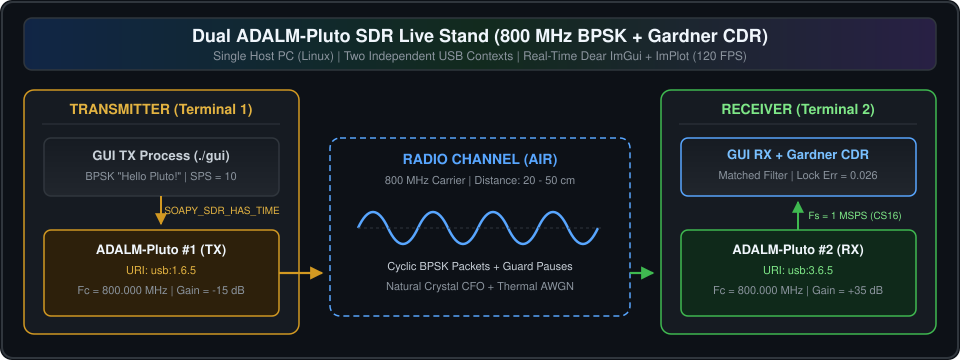
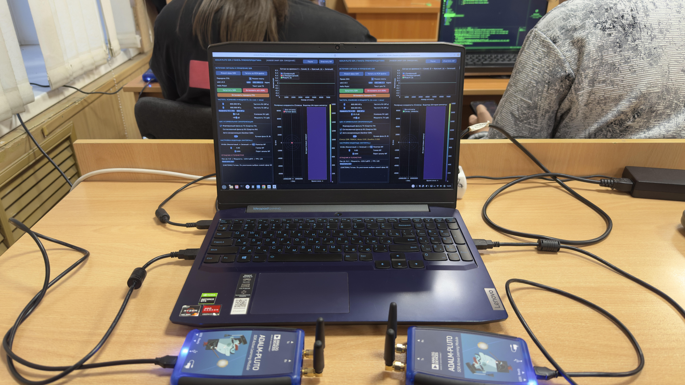
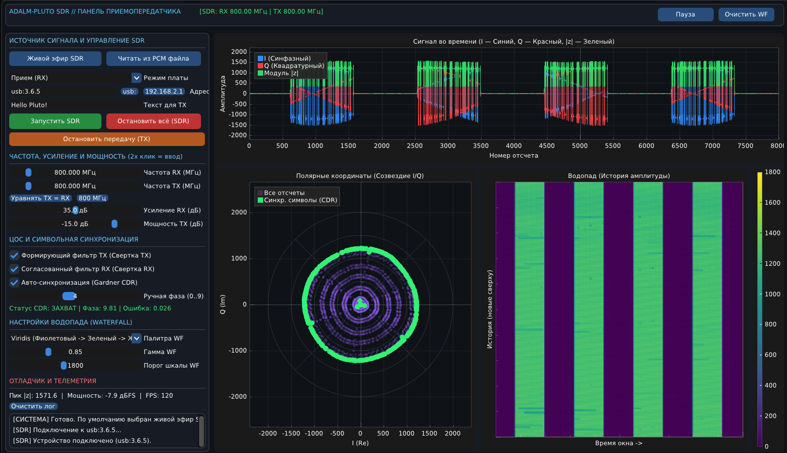

# Отчет по лабораторной работе №12: Стенд из двух ADALM-Pluto на одном ПК, управление частотой RX/TX на лету и живой захват Gardner CDR

<div align="left">
  
  
  
  
</div>

<br>

<div align="center">



</div>

---

## 1. Постановка задачи и цели недели

На 11-й неделе мы собрали графический интерфейс `gui.cpp` на базе Dear ImGui + ImPlot и отладили замкнутую петлю посимвольной синхронизации Гарднера на записанном файле `txdata.pcm`. На этой неделе задача — перейти от оффлайн-дампа к **живому радиоканалу между двумя физическими платами ADALM-Pluto**, подключёнными к одному ноутбуку.

**Цели текущей недели:**
1. Добавить в `dev/gui.cpp` раздельное управление несущими частотами **RX** и **TX** в диапазоне $70\text{–}6000\text{ МГц}$ с перестройкой на лету (без перезапуска потоков).
2. Найти и исправить причину «немого» передатчика при работе платы в режиме только передачи (`Передача (TX)`).
3. Подключить две платы ADALM-Pluto по USB к одному ноутбуку без конфликта сетевых интерфейсов и запустить два независимых окна `./gui` (передатчик и приёмник).
4. Проверить работу согласованного фильтра и автомата Гарднера в реальном радиоэфире на частоте $800\text{ МГц}$, разобрать форму всех трёх графиков и записать динамику работы.

---

## 2. Сборка стенда из двух ADALM-Pluto на одном ноутбуке

Обе платы подключены по USB к одному ноутбуку и лежат на столе с накрученными антеннами на расстоянии ~20–30 см друг от друга. На экране параллельно открыты два экземпляра программы `./gui`: левое окно управляет передатчиком, правое — приёмником.

<div align="center">
  
  <br>
  <em>Рис. 1. Лабораторный стенд: две платы ADALM-Pluto подключены по USB к одному ноутбуку, на экране запущены два окна GUI (TX и RX).</em>
</div>

### Разделение двух плат по USB-адресам

По умолчанию каждая плата ADALM-Pluto поднимает виртуальный сетевой интерфейс с одинаковым адресом `192.168.2.1`. При одновременном подключении двух устройств обращение по IP вызывает конфликт, поэтому уникальные USB-контексты обеих плат были получены командой `iio_info -s`:

```text
2: 0456:b673 (Analog Devices Inc. PlutoSDR with timestamp support), serial=104473...86e7 [usb:1.6.5]
3: 0456:b673 (Analog Devices Inc. PlutoSDR with timestamp support), serial=104473...f2b0 [usb:3.6.5]
```

* **Терминал 1 (Передатчик TX):** адрес `usb:1.6.5`, режим `Передача (TX)`, частота `800.000 МГц`, мощность `-15.0 дБ`, передаваемая строка `"Hello Pluto!"`.
* **Терминал 2 (Приёмник RX):** адрес `usb:3.6.5`, режим `Прием (RX)`, частота `800.000 МГц`, усиление `+35.0 дБ`, включены согласованный фильтр RX и `Gardner CDR`.

---

## 3. Доработки `dev/gui.cpp` и процессы внутри программы

### 3.1. Перестройка частот RX и TX на лету

В структуру `SdrControlState` добавлены атомарные переменные `rx_freq_hz`, `tx_freq_hz` и флаг `freq_dirty`. При изменении ползунка (или точном вводе числа с клавиатуры по двойному клику ЛКМ) фоновый поток без остановки стрима вызывает `SoapySDRDevice_setFrequency(...)`. Для удобства добавлены быстрые кнопки **`Уравнять TX = RX`** и **`800 МГц`**.

### 3.2. Исправление ошибки в режиме `Передача (TX)`

При первом запуске двух плат приёмник видел только усиленный тепловой шум (`Пик |z| = 21.2`), хотя передатчик успешно подключался. Причина оказалась в режиме работы драйвера с параметрами `direct=1, timestamp_every=1920`: прошивка принимает буферы передачи только с аппаратной меткой времени (`SOAPY_SDR_HAS_TIME`). Когда в левом окне выбирался режим `Передача (TX)`, поток `rxStream` не открывался, счётчик времени `last_time` оставался равен `0`, и плата отбрасывала отправляемые буферы.

**Исправление в `SdrWorkerThread()`:** в режиме `TX` поток `rxStream` открывается в фоне для чтения актуального аппаратного времени FPGA (`last_time`), а запись в `txStream` всегда идёт с флагом `SOAPY_SDR_HAS_TIME`:

```cpp
int current_mode = g_ctrl.mode.load();
bool show_rx = (current_mode == 0 || current_mode == 2);
bool do_tx   = (current_mode == 1 || current_mode == 2);
// rxStream нужен также в режиме TX для чтения аппаратных часов FPGA (last_time)
bool need_rx_stream = show_rx || do_tx;

...

if (do_tx && txStream && g_ctrl.tx_enabled.load() && last_time > 0) {
    long long tx_time = last_time + 4000000LL;
    for (size_t i = 0; i < 8; ++i) {
        uint8_t b = (tx_time >> (i * 8)) & 0xff;
        tx_buff[2 + i] = (int16_t)(b << 4);
    }
    void* tx_buffs[] = {tx_buff.data()};
    int flags_tx = SOAPY_SDR_HAS_TIME;
    SoapySDRDevice_writeStream(sdr, txStream, (const void* const*)tx_buffs, tx_mtu, &flags_tx, tx_time, 200000);
}
```

Дополнительно на верхнем графике заданы начальные пределы оси Y `[-2200, 2200]`, чтобы при отсутствии сигнала график не приближался автоматически до масштаба `[-0.5, 0.5]`.

### 3.3. Как устроена работа GUI и почему передача идёт циклически

Чтобы чтение и запись по USB не замораживали интерфейс, программа разделена на два независимых потока:

1. **Фоновый поток `SdrWorkerThread` (`std::thread`):**
   * Держит соединение с платой и применяет изменения из GUI через атомарные флаги (`freq_dirty`, `gain_dirty`, `tx_rebuild_dirty`, `tx_enabled`).
   * В цикле `while (g_ctrl.sdr_running.load())` **циклически** отправляет готовый BPSK-буфер со строкой `"Hello Pluto!"` (сформированный функцией `BuildBpskBuffer` с защитной паузой тишины в конце буфера). Именно поэтому передача идёт непрерывно, пакет за пакетом, пока активен TX.
   * На приёмнике читает сырые комплексные отсчёты (`1 MSPS`) из `rxStream`, собирает окно длиной `VIEW_SAMPLES = 8000` и передаёт его в главный поток под мьютексом `iq_mutex`.

2. **Главный поток ЦОС и отрисовки (`120 FPS`):**
   * Забирает свежий кадр `live_I / live_Q`, считает пиковую амплитуду `Пик |z|` и мощность в `дБFS`.
   * Прогоняет сигнал через согласованный фильтр RX (`ApplyMatchedFilter`, скользящее окно $\text{SPS} = 10$).
   * Выполняет посимвольную синхронизацию (`RunGardnerSymbolSync`: интерполятор Фарроу + детектор ошибки Гарднера + ПИ-фильтр).
   * Сдвигает матрицу водопада `waterfall_grid` вниз на одну строку, записывает сверху свежую строку амплитуд и отрисовывает интерфейс через `ImGui` + `ImPlot`.

---

## 4. Подробный разбор живого приёма (`live_rx_gui.jpg`)

На скриншоте ниже зафиксирована работа окна приёмника (`usb:3.6.5`) в реальном времени при активном передатчике (`usb:1.6.5`) на частоте $800.000\text{ МГц}$:

<div align="center">
  
  <br>
  <em>Рис. 2. Окно приёмника (usb:3.6.5) во время живой передачи по эфиру на 800 МГц: 4 принятых BPSK-пакета, устойчивый захват Gardner CDR (ошибка 0.026) и стабильный водопад.</em>
</div>

### 4.1. Показатели левой панели (телеметрия)

* **Режим и частоты:** `Прием (RX)`, `usb:3.6.5`, `Частота RX = 800.000 МГц`, `Усиление RX = 35.0 дБ`.
* **Уровень принимаемого сигнала:** `Пик |z| = 1571.6`, средняя мощность `-7.9 дБFS`. Это оптимальный рабочий диапазон для 12-битного АЦП: сигнал намного выше уровня шума, но далёк от насыщения (клиппинга).
* **Синхронизация Гарднера:** `Статус CDR: ЗАХВАТ | Фаза: 9.81 | Ошибка: 0.026`. Низкая средняя ошибка детектора (`0.026`) подтверждает точное удержание вершин символов, а дробная фаза (`9.81`) в реальном времени отслеживает медленный дрейф тактовых генераторов двух плат.
* **Производительность:** `FPS: 120` — вся обработка окна из 8000 отсчётов и отрисовка трёх графиков идут без потерь кадров.

### 4.2. Почему диаграммы выглядят именно так

1. **Сигнал во времени (верхний график: $I$ — синий, $Q$ — красный, $|z|$ — зелёный):**
   * В окно длиной $8000$ отсчётов попадают **4 полных BPSK-пакета** и ровные участки тишины между ними — это прямой результат циклической отправки буфера `"Hello Pluto!"`.
   * **Зелёная линия ($|z| = \sqrt{I^2 + Q^2}$)** держится в районе `1500` на протяжении всего пакета и проваливается к нулю только в моменты смены фазы BPSK на $180^\circ$ (при переходе между битами `0` и `1`) и в паузах.
   * **Синий ($I$) и красный ($Q$) каналы** плавно перетекают друг в друга по синусоидальной огибающей. Причина — естественная разница частот кварцевых резонаторов двух разных плат (Carrier Frequency Offset, CFO), из-за которой фаза принятого сигнала медленно вращается.

2. **Полярные координаты / Созвездие $I/Q$ (нижний левый график):**
   * **Фиолетовые концентрические кольца («Все отсчеты»):** на выходе согласованного фильтра ($\text{SPS} = 10$) прямоугольные импульсы передатчика превращаются в треугольные. Когда окно фильтра проходит границу двух противоположных битов (`+1` и `-1`), их амплитуды частично вычитаются, давая набор промежуточных радиусов — они и образуют серию вложенных фиолетовых колец.
   * **Ярко-зелёное внешнее кольцо («Синхр. символы (CDR)»):** интерполятор Фарроу и детектор Гарднера берут выборки строго в вершинах треугольных импульсов, где энергия текущего бита максимальна, а влияние соседнего равно нулю ($\text{ISI} = 0$). Поэтому **ни одна зелёная точка не попадает на внутренние фиолетовые кольца** — все информационные символы легли на внешнюю окружность.
   * **Зелёное пятно в центре `(0, 0)`:** это выборки, попавшие на защитные паузы тишины между пакетами.
   * **Почему на графике кольцо, а не две точки:** петля Гарднера синхронизирует только *момент времени* взятия отсчёта и инвариантна к фазе. Вращение точек по окружности вызвано расстройкой частот гетеродинов (CFO) двух плат; остановка этого вращения и стягивание кольца в две точки BPSK (`+A` и `-A`) — задача следующего этапа (петля Костаса / Costas Loop, Глава 7 учебника).

3. **Водопад / История амплитуды (нижний правый график):**
   * Отображает историю изменения амплитуды во времени (новые кадры добавляются сверху, палитра `Viridis`, шкала `0..1800`).
   * Четыре яркие **зелёные вертикальные полосы** соответствуют активным пакетам, а **тёмно-фиолетовые промежутки** — паузам тишины. Чёткие вертикальные границы без сдвигов и разрывов подтверждают стабильную передачу данных по USB без пропусков буферов.

---

## 5. Демонстрация работы в реальном времени (Видео)

Ниже представлена запись работы стенда в динамике (без звука): видны непрерывный приём BPSK-пакетов по эфиру, вращение фазы от CFO и устойчивое удержание захвата петлёй Гарднера.


---

## 6. Исходный код проекта

* 👉 **[src/gui.cpp](../../src/gui.cpp)** — обновлённый дашборд с управлением частотами RX/TX (`70–6000 МГц`), исправленной передачей с аппаратными метками времени и синхронизацией Гарднера.
* 👉 **[src/main.cpp](../../src/main.cpp)** — консольный приемопередатчик с согласованной фильтрацией и Gardner CDR.
* 👉 **[src/CMakeLists.txt](../../src/CMakeLists.txt)** — конфигурация сборки проекта.

---

## 7. Выводы

1. В `dev/gui.cpp` реализована перестройка несущих частот RX и TX на лету ($70\text{–}6000\text{ МГц}$) и устранена ошибка передачи в режиме `TX` за счёт фонового чтения аппаратных меток времени FPGA (`SOAPY_SDR_HAS_TIME`).
2. Собран и запущен живой радиоканал между двумя платами ADALM-Pluto (`usb:1.6.5` → `usb:3.6.5`) на одном ПК на частоте $800.000\text{ МГц}$.
3. В реальном радиоэфире подтверждена работа согласованного фильтра и замкнутой петли Гарднера: контур устойчиво держит захват (`ошибка TED = 0.026`), полностью отделяя информационные символы от внутренних колец межсимвольной интерференции при $120\text{ FPS}$.
4. Следующий шаг — внедрение петли Костаса (Costas Loop) для компенсации CFO, остановки вращения созвездия и декодирования принятой строки `"Hello Pluto!"`.
