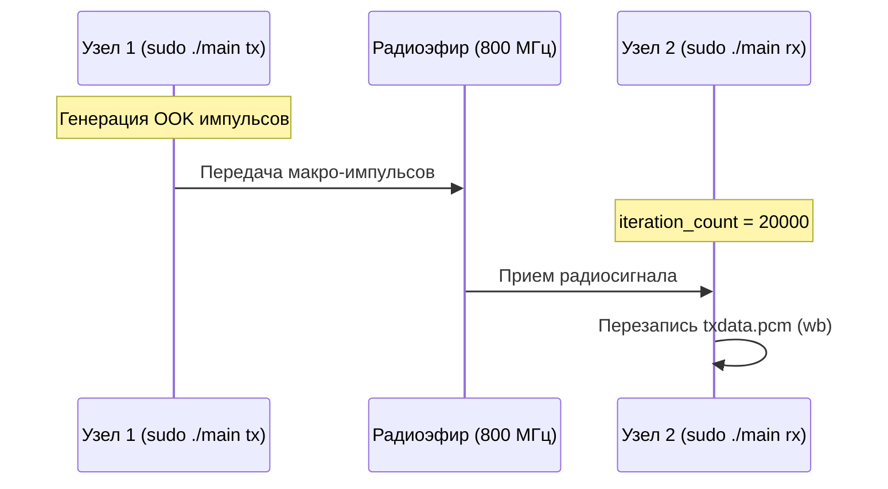

<div align="center">
  
# Отчет по лабораторной работе: Модернизация приемопередатчика и генерация OOK-сигналов

  
  
  
  
  
  

</div>

> **Период выполнения:** Неделя 7 (19.10 - 25.10)  
> **Тема:** Разработка универсального кода с запуском по флагам, реализация амплитудной манипуляции (OOK) и анализ математической огибающей радиосигнала.

---

## 📡 1. Переход к универсальной архитектуре (Запуск с флагами)

Главной архитектурной задачей седьмой недели стал уход от "костыльного" ручного закомментирования строк кода для переключения плат между режимами передачи и приема. 

Был написан единый универсальный файл `main.cpp`, который принимает аргументы командной строки (`tx` или `rx`) и динамически инициализирует только нужные потоки и буферы. Это позволило использовать один и тот же бинарный файл на обоих ноутбуках.



**Фрагмент C++ кода (парсинг флагов):**
```cpp
int main(int argc, char *argv[]) {
    int is_tx = 0, is_rx = 0;

    // Выбор режима (Tx или Rx) через аргументы командной строки
    if (argc > 1 && strcmp(argv[1], "tx") == 0) {
        is_tx = 1;
    } else if (argc > 1 && strcmp(argv[1], "rx") == 0) {
        is_rx = 1;
    } else {
        printf("Ошибка! Запускайте так: sudo ./main tx ИЛИ sudo ./main rx\n");
        return EXIT_FAILURE;
    }

    // Избирательная настройка параметров
    if (is_rx) SoapySDRDevice_setSampleRate(sdr, SOAPY_SDR_RX, 0, 1e6);
    if (is_tx) SoapySDRDevice_setSampleRate(sdr, SOAPY_SDR_TX, 0, 1e6);
    // ...
```

---

## 🛠 2. Проблемы при организации связи и их решения

При запуске нового кода мы столкнулись с рядом физических и программных аномалий, которые потребовали оперативного вмешательства.

### 🗑 2.1. Мусор в данных и "белый шум" на графиках
- **Симптоматика:** При отрисовке принятого сигнала в Python вместо ожидаемых импульсов наблюдался сплошной хаотичный шум. График не соответствовал текущей передаче.
- **Диагностика:** Файл буфера `txdata.pcm` открывался в режиме `w` или `a+`, из-за чего новые порции данных дозаписывались к остаткам старых, прерванных симуляций. Скрипт читал "исторический мусор".
- **Решение:** Изменен режим открытия файла на строго бинарную перезапись `wb`. Теперь при каждом запуске приемника файл гарантированно создается с нуля:
  ```cpp
  FILE *file = fopen("txdata.pcm", "wb");
  ```

### ⏱ 2.2. Рассинхронизация запуска (Разминулись в эфире)
- **Симптоматика:** Приемник записывал идеальную тишину, несмотря на работающий рядом передатчик.
- **Диагностика:** Окно работы программы составляло всего 1000-2000 итераций (доли секунды). При ручном запуске программ на двух разных ноутбуках было невозможно нажать `Enter` идеально синхронно.
- **Решение:** Окно прослушивания для режима `rx` было экстремально расширено до `20000` итераций (около 10-15 секунд). Это позволило приемнику заблаговременно "встать на прослушку" и гарантированно захватить сигнал, когда включается передатчик.

### 🛑 2.3. Зависание платы (Failed to stop RX stream)
- **Симптоматика:** После завершения итераций в консоль выводилась ошибка `[ERROR] Failed to stop RX stream (-1)`, плата переставала отвечать на новые команды до физического переподключения по USB.
- **Диагностика:** Из-за введения флагов `is_rx` и `is_tx`, функции деактивации потоков оказались закомментированы или недоступны, что приводило к аппаратному переполнению буферов AD9361.
- **Решение:** Добавлено жесткое и явное освобождение ресурсов для каждого из режимов:
  ```cpp
  if (is_rx) {
      SoapySDRDevice_deactivateStream(sdr, rxStream, 0, 0);
      SoapySDRDevice_closeStream(sdr, rxStream);
  }
  ```

---

## 🧮 3. Амплитудная манипуляция (OOK) и расчет огибающей

Вместо примитивной трапеции в Baseband, была реализована настоящая генерация радиоимпульсов — амплитудная манипуляция (On-Off Keying). Половину буфера передатчик излучает чистый синус (10 кГц), вторую половину — выдает нули.

**Генерация сигнала (C++):**
```cpp
double f_tone = 10000.0; // Частота синусоиды внутри импульса (10 кГц)
for (size_t i = 0; i < N; i++) {
    if (i < N / 2) {
        double phase = 2.0 * M_PI * f_tone * ((double)i / 1e6);
        tx_buff[2 * i]     = (int16_t)(max_amp * cos(phase)); // I
        tx_buff[2 * i + 1] = (int16_t)(max_amp * sin(phase)); // Q
    } else {
        tx_buff[2 * i] = 0;       
        tx_buff[2 * i + 1] = 0;   
    }
}
```

Для того чтобы избавить график от высокочастотных биений несущей и визуализировать истинную форму прямоугольных пачек, Python-скрипт был дополнен математическим вычислением огибающей (модуля) комплексного сигнала с использованием библиотеки `numpy`:

$$
Envelope = \sqrt{I^2 + Q^2}
$$

---

## 📸 4. Результаты эксперимента (Осциллограмма эфира)

После применения всех программных исправлений, синхронизации запуска и расчета огибающей, был получен следующий результат:

<p align="center">
  
  <br>
  <em>Рис. 1. Осциллограмма принятого сигнала: четко видны макро-импульсы (слева) и работа аппаратной АРУ (понижение амплитуды после первого пика).</em>
</p>

**Интерпретация результата:**
1. **Зеленый «забор» слева** — это успешно демодулированные (через вычисление огибающей) радиоимпульсы. Математика идеально "собрала" синусоиду в плотные прямоугольные блоки.
2. **Пик в начале (до 3000)** — наглядная демонстрация работы системы автоматической регулировки усиления (АРУ) на плате приемника. При пустом эфире LNA был выкручен на максимум, а после детектирования нашего сигнала усиление плавно снизилось до рабочей нормы (~1800).
3. **Ровная линия справа** — чистая шумовая полка (Noise Floor) после штатного отключения передатчика.

## Заключение
В ходе 7 недели был успешно внедрен универсальный C++ код с маршрутизацией через аргументы командной строки. Решены критические проблемы с аппаратным зависанием буферов и рассинхронизацией запуска. Реализована генерация и математическая демодуляция сигналов амплитудной манипуляции (OOK), что подтверждается кристально чистым графиком огибающей радиосигнала.
