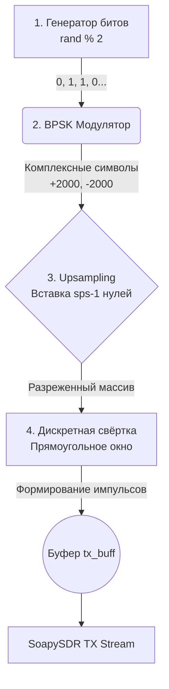

  
# Отчет по лабораторной работе: ЦОС, BPSK-модуляция и анализ аппаратных искажений (CFO, LO Leakage)

  
  
  
  

> **Период выполнения:** Неделя 8 (26.10 - 01.11)  
> **Тема:** Разработка конвейера цифровой обработки сигналов (генерация битов, модуляция BPSK, upsampling, свёртка) и анализ физических особенностей радиоканала.

---

## 📡 1. Архитектура передатчика (Конвейер ЦОС)

На данной неделе была реализована полноценная программная цифровая обработка сигналов (DSP) для передатчика. Вместо генерации примитивных синусоид, мы реализовали классический стек формирования цифрового сигнала. Выбор пал на модуляцию **BPSK** (Binary Phase-Shift Keying), так как она обладает высокой помехоустойчивостью и наглядна для отладки (использует только синфазный канал $I$).

**Схема обработки сигнала:**

### Разбор этапов (С++ реализация):
Полный исходный код передатчика доступен в файле [`main_3.cpp`](main_3.cpp).

1. **Генератор битов:** Создается массив случайных нулей и единиц заданной длины.
2. **Модуляция (BPSK Mapper):** Биты преобразуются в уровни напряжения. Логический `0` отображается в амплитуду $+2000$, а `1` — в $-2000$. Квадратурный канал ($Q$) при этом остается строго нулевым.
3. **Upsampling (Передискретизация):** Для того чтобы один символ длился определенное время в эфире, мы задали параметр `sps = 16` (samples per symbol). Между каждым модулированным символом вставляется $L-1 = 15$ нулей.
4. **Свёртка (Convolution):** Разреженный массив "иголок" сворачивается с прямоугольным фильтром $h[k] = [1, 1, \dots, 1]$ длиной 16. Дискретная свёртка выполняется по формуле:
   $$y[n] = \sum_{k=0}^{L-1} x[n - k] \cdot h[k]$$
   Этот математический трюк "размножает" одиночный импульс, превращая его в идеальную прямоугольную ступеньку, готовую к передаче в ЦАП.

---

## 🛠 2. Проблемы визуализации и их решения (Troubleshooting)

При попытке обработать записанный приемником сигнал (файл `txdata.pcm` весом около 90 МБ) мы столкнулись с рядом проблем в скрипте аналитики. Исходный код Python доступен в файле [`readPcm.py`](readPcm.py).

### ⏳ Проблема 1: Экстремально долгая отрисовка графиков
* **Симптоматика:** Python-скрипт обрабатывал файл и строил график около 1.5 минут.
* **Причина:** Побайтовое чтение огромного файла через цикл `while` в стандартные списки Python. Массив содержал более 22 миллионов точек, отчего `matplotlib` "захлебывался".
* **Решение:** Полный отказ от циклов в пользу векторизации библиотеки NumPy. Применена функция `np.fromfile()`, которая читает бинарный дамп в память за доли секунды.

### ✂️ Проблема 2: Поиск полезного сигнала в "белом шуме"
* **Симптоматика:** На графике в 20+ млн сэмплов сигнал выглядел как тонкая неразличимая полоска.
* **Причина:** Окно прослушивания приемника было задано широким (`iteration_count = 20000`), чтобы гарантированно поймать передатчик. 90% файла составлял пустой эфир.
* **Решение:** Внедрена ручная обрезка по индексам. Анализируя общую картину, мы локализовали пачку импульсов и жестко вырезали массив от $1.10 \cdot 10^7$ до $1.14 \cdot 10^7$ сэмплов, центрировав график на полезных данных.

### 🌌 Проблема 3: Слипание диаграммы созвездия
* **Симптоматика:** Созвездие выглядело как сплошное, непрозрачное фиолетовое пятно (пончик).
* **Решение:** В параметры `scatter` графика была добавлена высокая прозрачность (`alpha = 0.1`), а сам массив прорежен в 10 раз (`step = 10`). Это вернуло графику текстуру, позволив увидеть плотность точек на кольцах.

---

## 📸 3. Анализ радиоэфира (Аппаратные искажения)

Ниже представлен финальный результат работы программно-аппаратного комплекса. На графиках зафиксирована не идеальная математика, а **реальная физика радиоканала** со всеми аппаратными искажениями плат ADALM-Pluto.

  
   
  <em>Рис. 1. Слева: принятая пачка BPSK импульсов. Справа: Диаграмма созвездия (CFO).</em>

### Разбор графика во времени (Слева)
1. **Прямоугольные BPSK импульсы:** Резкие скачки синего ($I$) и красного ($Q$) графиков — это успешно принятые и сглаженные фильтрами ступеньки нашей свёртки. Огибающая (зеленая линия, $|z|$) четко очерчивает границы пачки. Амплитуда упала с исходных 2000 до ~500 из-за затухания волны в воздухе.
2. **Просачивание гетеродина (LO Leakage):** Обратите внимание на участок до начала пачки импульсов. Вместо абсолютного нуля, там видна низкочастотная синусоида амплитудой около 100. Это аппаратное явление: синтезатор частоты чипа AD9361 излучает слабую паразитную несущую волну даже тогда, когда цифровой буфер передатчика заполнен нулями.

### Разбор диаграммы созвездия (Справа)
Идеальная BPSK-модуляция должна отображаться как два плотных облака точек на оси X (значения $+A$ и $-A$). Однако мы наблюдаем фиолетовые кольца.
1. **Сдвиг несущей частоты (CFO):** Платы приемника и передатчика тактируются от разных кварцевых резонаторов. Из-за разности их частот ($\Delta f$) фаза принятого сигнала непрерывно вращается по закону $e^{j 2 \pi \Delta f t}$. Идеальные точки BPSK начинают бегать по кругу, формируя внешнее плотное кольцо. Это доказывает отсутствие аппаратной синхронизации (кабеля) между устройствами.
2. **Внутренние кольца:** Возникают в моменты переключения битов BPSK (переход от $+A$ к $-A$). Из-за встроенных FIR-фильтров на плате Pluto, сигнал не прыгает мгновенно, а плавно скатывается по склону. АЦП захватывает эти промежуточные значения, а вращение фазы (CFO) размазывает их в идеально ровные внутренние орбиты.

## 🏁 Вывод
Завершен полный цикл ЦОС для передатчика. Успешно решены проблемы работы с Big Data в Python. Наглядно зафиксированы и научно обоснованы такие сложные радиотехнические эффекты, как Local Oscillator Leakage и Carrier Frequency Offset. Алгоритм готов к дальнейшему внедрению цепей синхронизации и демодуляции.
