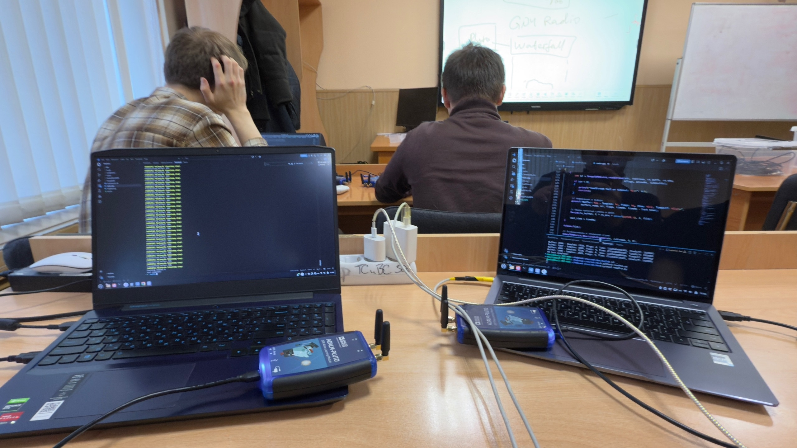
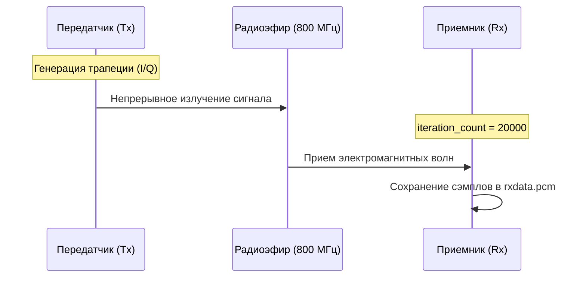
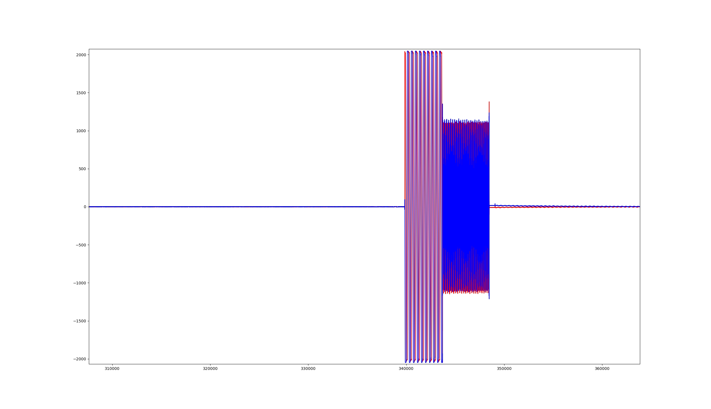

<div align="center">
  
# Отчет по настройке ADALM-Pluto и программной генерации сигналов

  
  
  
  
  

</div>

> **Период выполнения:** Недели 4, 5, 6 (28.09 - 18.10)  
> **Тема:** Организация радиоканала связи между двумя платами SDR, программная обработка и демодуляция сигналов.

---

## 📸 1. Аппаратная установка (Фотоотчет)

Для подтверждения успешного проведения натурного эксперимента ниже представлена фотография нашего стенда. На ней запечатлены два независимых компьютера, к каждому из которых по USB подключена плата ADALM-Pluto (одна выполняет роль передатчика Tx, другая — приемника Rx).

<p align="center">
  
  <br>
  <em>Рис. 1. Рабочее место: стенд с двумя независимыми устройствами ADALM-Pluto, готовыми к передаче сигнала.</em>
</p>

---

## 📡 2. Разделение логики приемопередатчика на два независимых устройства (Tx и Rx)

Главной задачей данного этапа практики являлся переход от тестирования одной платы (loopback) к полноценной передаче сигнала по радиоканалу между двумя физически независимыми устройствами. 

Для этого программный код `main.cpp` был модифицирован. Вместо одновременной активации потоков приема и передачи на одном устройстве, была внедрена логика маршрутизации на основе аргументов командной строки. Это позволило использовать единый бинарный файл на обоих ноутбуках, назначая им разные роли.

* 🔹 **Устройство 1 (Ноутбук Rx - Приемник):** Инициализирует только поток `SOAPY_SDR_RX`. Окно прослушивания эфира было значительно увеличено (`iteration_count = 20000`), что обеспечило гарантированный захват сигнала длительностью около 8-10 секунд.
* 🔸 **Устройство 2 (Ноутбук Tx - Передатчик):** Инициализирует поток `SOAPY_SDR_TX`. Генерирует трапециевидный импульс в Baseband (базовой полосе частот) и осуществляет его непрерывную передачу в эфир.



**Фрагмент C++ кода (маршрутизация логики):**
```cpp
// Определение режима работы через аргументы командной строки
int main(int argc, char *argv[]) {
    bool is_tx = false, is_rx = false;
    
    if (argc > 1 && argv[1][0] == 't') {
        is_tx = true; // Режим передачи
    } else {
        is_rx = true; // Режим приема (по умолчанию)
    }

    // Избирательная активация потоков
    if (is_rx) SoapySDRDevice_activateStream(sdr, rxStream, 0, 0, 0);
    if (is_tx) SoapySDRDevice_activateStream(sdr, txStream, 0, 0, 0);
    // ...
```

---

## 🛠 3. Проблемы при организации связи и их аппаратно-программные решения

В ходе пусконаладочных работ радиоканала был выявлен и устранен ряд критических ошибок.

### ⏱ 3.1. Предупреждения драйвера о рассинхронизации меток времени
* **Симптоматика:** При запуске передатчика консоль циклично выводила сообщение `[WARNING] Backwards timestamp step!`.
* **Диагностика:** В исходном коде, рассчитанном на работу одной платы, время отправки буфера (Tx) жестко привязывалось к времени получения буфера (Rx). При разделении логики передатчик перестал получать метки времени от приемника, а функция `writeStream` получала нулевые таймстемпы.
* **Решение:** Для непрерывного потокового вещания (streaming) точная синхронизация пакетов была отключена. Флаг отправки был изменен на `flags_tx = 0`. Предупреждение драйвера является штатной реакцией на асинхронный поток и не влияет на качество Baseband-сигнала.

### 📂 3.2. Ошибка файловой системы (FileNotFoundError)
* **Симптоматика:** Python-скрипт прерывал работу с ошибкой: `FileNotFoundError: [Errno 2] No such file or directory: 'build/txdata.pcm'`.
* **Диагностика:** Возникло две смежные проблемы:
  1. Попытка запуска аналитического скрипта на ноутбуке передатчика (где физически отсутствует процесс записи эфира).
  2. Жестко заданное имя файла в коде C++ (`rxdata.pcm`) не совпадало с именем файла, которое ожидал Python-скрипт (`txdata.pcm`).
* **Решение:** Исполнение аналитики было строго закреплено за ПК-приемником. В Python-скрипте переменная пути была скорректирована на `name = "build/rxdata.pcm"`.

### 📉 3.3. Отсутствие полезного сигнала (Белый шум)
* **Симптоматика:** При первичной отрисовке графика амплитуда сигнала колебалась в минимальных пределах (от -4 до 4 единиц). Трапециевидный импульс (с ожидаемой амплитудой 2000) полностью отсутствовал.

<p align="center">
  
  <br>
  <em>Рис. 2. Осциллограмма эфира (шум квантования АЦП) при недостаточном усилении передатчика.</em>
</p>

* **Диагностика:** Аппаратное усиление передатчика (`SOAPY_SDR_TX`) было ошибочно установлено на экстремально низкий уровень ослабления: `-40.0` дБ, что делало сигнал неотличимым от шумовой полки на расстоянии нескольких метров.
* **Решение:** С помощью утилиты `SoapySDRUtil --probe` был изучен доступный диапазон усиления (Full gain range). Параметр в коде был изменен на `0.0` (максимальная мощность излучения), что позволило "пробить" расстояние между антеннами.

---

## 🧮 4. Обработка принятого сигнала и расчет огибающей

После устранения аппаратных проблем полезный сигнал был успешно зафиксирован. Однако "сырой" график каналов $I$ (In-phase) и $Q$ (Quadrature) выглядел как плотный блок высокочастотных колебаний.

<p align="center">
  
  <br>
  <em>Рис. 3. Принятый сигнал в каналах I и Q (видны высокочастотные биения несущей).</em>
</p>

**Физическое обоснование явления:**
Данный эффект не является ошибкой. Он возникает из-за естественной аппаратной расстройки локальных осцилляторов (гетеродинов) на разных платах. Даже при настройке обеих плат ровно на 800 МГц, между ними всегда присутствует дельта в несколько сотен Герц. Эта дельта $\Delta f$ приводит к тому, что при даунконверсии (переносе частоты вниз на приемнике) базовый сигнал приобретает дополнительную фазовую модуляцию $e^{j2\pi\Delta ft}$. Визуально это выражается во "вращении" вектора сигнала в комплексной плоскости, что и дает синусоидальные колебания в квадратурах $I$ и $Q$.

**Программное решение (Математическая демодуляция):**
Для визуализации истинной формы переданного трапециевидного импульса необходимо избавиться от фазовых вращений. Для этого рассчитывается огибающая (магнитуда) комплексного сигнала по формуле:

$$
Envelope = \sqrt{I^2 + Q^2}
$$

Для реализации данного алгоритма был полностью переписан Python-скрипт с применением векторизованных вычислений библиотеки NumPy, что позволило мгновенно обработать миллионы сэмплов.

**Итоговый код Python (readPcm.py):**
```python
import numpy as np
import matplotlib.pyplot as plt

name = "build/rxdata.pcm"
real = []
imag = []

# Чтение бинарного PCM файла
with open(name, "rb") as f:
    index = 0
    while (byte := f.read(2)):
        val = int.from_bytes(byte, byteorder='little', signed=True)
        if index % 2 == 0:
            real.append(val)
        else:
            imag.append(val)
        index += 1

# Конвертация в высокопроизводительные массивы NumPy
real_np = np.array(real)
imag_np = np.array(imag)

# Расчет математической огибающей (Envelope)
envelope = np.sqrt(real_np**2 + imag_np**2)

# Визуализация полезного сигнала
plt.figure(figsize=(12, 6))
plt.title("Огибающая принятого трапециевидного сигнала", fontsize=14)
plt.xlabel("Сэмплы", fontsize=12)
plt.ylabel("Амплитуда", fontsize=12)
plt.plot(envelope, color='green', linewidth=1.5)
plt.grid(True, linestyle='--', alpha=0.7)
plt.show()
```

---

## Заключение

По итогам работы за 4, 5 и 6 недели был успешно организован стабильный, однонаправленный радиоканал между двумя SDR-системами. Были изучены и решены типовые проблемы аппаратного усиления и рассинхронизации осцилляторов, а применение математического анализа в Python позволило качественно извлечь переданный трапециевидный сигнал из зашумленного радиоэфира. Эксперимент подтвержден фотоотчетом и графиками.
